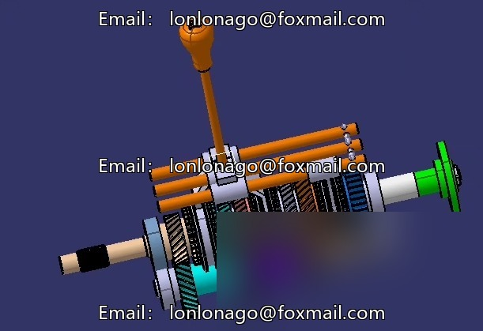
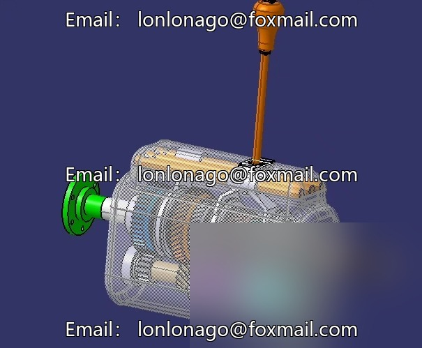
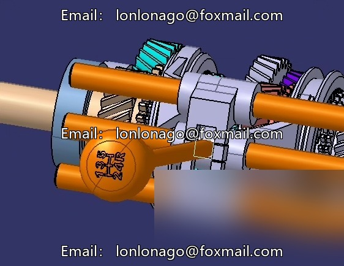

# 6-speed manual gearbox model data, mechanical gearbox 3D gearbox data model

## Body

6-range manual transmission number model of CAD; mechanical gearbox 3D model
Can be opened and edited with CATIA UG, SolidWorks, etc.
A014 There are other various types of 3D drawings as well, and specific details will be discussed further.

A mechanical transmission 3D data model, editable through catia UG or SolidWorks; A014 and other various 3D drawings are also available.

<!-- AI_ENRICHED -->

## Images

## Payment

Here is a pay link on Stripe ( https://buy.stripe.com/3cs8yP7sY87d0vu9AB ). Please contact me lonlonago@foxmail.com after funding $89, and I will send you a complete data files , thank you!

